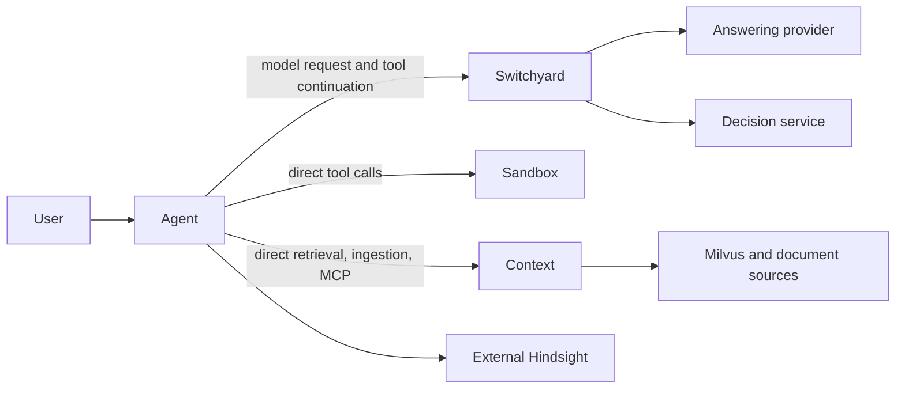

# Daedalus stack

Daedalus combines a chat application and agent runtime with model routing,
isolated execution, and information services. Start with the Agent for a working
chat loop, then add the services your workflow needs. The four submodules are
independently versioned and each owns its deployment and tests.

The [service integration guide](docs/service-integration.md) follows requests
across repositories and explains the configuration needed at each connection.

| Application | Ownership | Documentation |
| --- | --- | --- |
| Agent | User identity, chat queue, Rust agent loop, tool authorization and artifact publication | [Architecture](submodules/daedalus-agent/docs/architecture.md), [operations](submodules/daedalus-agent/docs/operations.md) |
| Switchyard | Model routing, classification, provider translation and streaming | [README](submodules/daedalus-switchyard/README.md) |
| Sandbox | Bubblewrap execution and offline verification; separate exploration v2 service | [README](submodules/daedalus-sandbox/README.md) |
| Context | Curated ingestion, retrieval, embedding/reranking and infrastructure MCP services | [README](submodules/daedalus-context/README.md) |



The Agent runs the model/tool loop. After a model proposes a tool call, the Agent
executes it and includes its result in the next model request. Switchyard routes
that request and streams the provider's response. Sandbox and Context APIs are
direct tool dependencies of the Agent. Hindsight supplies durable memory from
an externally maintained service.

## Start developing

Initialize the pinned checkouts from this repository:

```bash
git submodule update --init --recursive
git submodule status
```

For local text chat, follow the [Agent setup](submodules/daedalus-agent/README.md#local-setup).
It uses Compose and can call a model provider directly. You do not need to bring
up GPU retrieval services or a sandbox to develop the chat loop.

| You want to change | Start here |
| --- | --- |
| Chat, streaming, tools or user identity | [Agent architecture](submodules/daedalus-agent/docs/architecture.md) |
| Model selection, provider settings or protocol translation | [Switchyard configuration](submodules/daedalus-switchyard/README.md#provider-configurations) |
| Command execution, code checks or durable experiments | [Sandbox architecture](submodules/daedalus-sandbox/ARCHITECTURE.md) |
| Document ingestion, retrieval or infrastructure MCP tools | [Context development](submodules/daedalus-context/CONTRIBUTING.md) |
| Connections between services or a complete task flow | [Service integration](docs/service-integration.md) |

Each owner's `AGENTS.md` and contributor guide describe its local checks. Keep
application changes in that submodule; use the parent for shared guidance.

## Shared contracts

Automatic routing chooses `max`, `high`, `low` or `instant` for the task and
keeps the selected target through its tool continuations. Explicit public aliases and provider-native
reasoning values are separate contracts. Omission of the Agent's `model_profile`
uses its configured main model; set that model to `daedalus` at the Switchyard
endpoint for automatic routing. `none` is not a public effort option. Discover Switchyard's
`routes_*.toml` files and explicitly select a route file for probes or deployment.

Context's topology, RAG schema, collection and environment contracts define its
service settings. Generate consumer settings with its `make render-agent-env`,
then reconcile them with the agent workflow and Helm values. Generation does not
deploy services or provide credentials. Query and ingestion embedding spaces must
match beyond vector dimension. Check citations, collection state and actual agent
results separately from provider readiness.

Sandbox v1 execution uses authenticated discovery and structured requests. An
uncertain execution POST must not be blindly replayed. Workspaces are pod-local;
collected files require agent publication to become downloadable. Exploration v2
has separate grants, durable jobs, storage and recovery contracts.

The [service integration guide](docs/service-integration.md) explains these
connections with configuration mappings and request flows. For measured changes
across owners, the [co-design workflow](.agents/skills/daedalus-co-design/SKILL.md)
provides focused checks and experiment guidance.

## Deploy the current checkout

From any application submodule, `make deploy` builds and publishes its selected
repository-owned images, then upgrades the existing Kubernetes release using
that checkout's configuration. Configure the repository's local deployment
settings first. Switchyard requires an explicit provider selection; save
`ROUTES_FILE` in its private `.env` for repeated plain `make deploy` runs.

Keep release names, namespaces and storage settings stable when updating an
installation. Normal deployment does not uninstall releases, delete namespaces
or PVCs, reset databases, or rebuild collections. Pinned third-party services
retain their owning deployment contracts. Application pods may restart; sandbox
v1 workspaces remain pod-local temporary state. Deployment is not a storage
migration or a durable checkpoint of in-flight work.

See each submodule's deployment guide for preflight checks, component selection,
image configuration and rollout verification. These commands write registries
and the cluster; run local tests instead when only reviewing source changes.

## Validation and changes

Run local checks in each changed repository, then exercise the connection your
change affects. For example, a sandbox adapter change needs a staged-file request
and a returned result through the Agent; a retrieval change needs a known query
and the expected source passage. See the integration guide's
[development checks](docs/service-integration.md#develop-and-check-a-change).

The co-design workflow captures bounded read-only runtime evidence and stores
raw logs and run reports under ignored `.artifacts/daedalus-co-design/`.
Context cluster access additionally requires its local environment/context guard.
Missing access, empty logs and unavailable built-image checks remain explicit
gaps. Live policy tuning requires an explicitly selected route and matched
quality/latency evaluation; ordinary reviews use local fixtures.

Keep changes and commits in their owning repositories. Preserve unrelated work;
advance parent gitlinks only to intended, available commits when requested.
