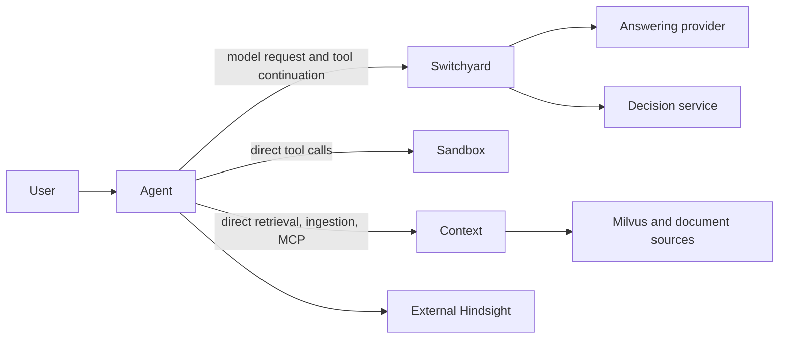

# Daedalus stack

This monorepo coordinates four independently versioned applications. Each
submodule owns its code, deployment and tests; the parent owns shared integration
guidance and the [co-design workflow](.agents/skills/daedalus-co-design/SKILL.md).

| Application | Ownership | Documentation |
| --- | --- | --- |
| Agent | User identity, chat queue, Rust agent loop, tool authorization and artifact publication | [Architecture](submodules/daedalus-agent/docs/architecture.md), [operations](submodules/daedalus-agent/docs/operations.md) |
| Switchyard | Model routing, classification, provider translation and streaming | [README](submodules/daedalus-switchyard/README.md) |
| Sandbox | Bubblewrap execution and offline verification; separate exploration v2 service | [README](submodules/daedalus-sandbox/README.md) |
| Context | Curated ingestion, retrieval, embedding/reranking and infrastructure MCP services | [README](submodules/daedalus-context/README.md) |

The agent retains tool results and sends them in subsequent model requests.
Switchyard owns model continuation transport and selection; it does not execute
tools or proxy sandbox/context APIs. Hindsight's implementation is externally
owned. Private uploads retain agent user scope even when they share context
infrastructure. The agent's minimal local setup can use a provider directly
without the other submodules.

## Shared contracts

Automatic routing classifies every model request, including tool continuations,
into `max`, `high`, `low` or `instant`. Explicit public aliases and provider-native
reasoning values are separate contracts. Omit the agent's `model_profile` for
automatic routing. `none` is not a public effort option. Discover Switchyard's
`routes_*.toml` files and explicitly select a route file for probes or deployment.

Context's topology, RAG schema, collection and environment contracts define its
service settings. Generate consumer settings with its `make render-agent-env`,
then reconcile them with the agent workflow and Helm values. Generation does not
deploy services or provide credentials. Query and ingestion embedding spaces must
match beyond vector dimension. Check citations, collection state and actual agent
results separately from provider readiness.

Sandbox v1 execution uses authenticated discovery and structured requests. An
uncertain execution POST must not be blindly replayed. Workspaces are pod-local;
collected files require agent publication to become downloadable. Exploration v2
has separate grants, durable jobs, storage and recovery contracts.

See the [joint contract map](.agents/skills/daedalus-co-design/references/contract-map.md)
for source paths and focused checks. Each owner's `AGENTS.md` applies within its
submodule. Shared skill lessons stay in this parent, outside application runtime
skill catalogs.

## Deploy the current checkout

From any application submodule, `make deploy` builds and publishes its selected
repository-owned images, then upgrades the existing Kubernetes release using
that checkout's configuration. Configure the repository's local deployment
settings first. Switchyard requires an explicit provider selection; save
`ROUTES_FILE` in its private `.env` for repeated plain `make deploy` runs.

Keep release names, namespaces and storage settings stable when updating an
installation. Normal deployment does not uninstall releases, delete namespaces
or PVCs, reset databases, or rebuild collections. Pinned third-party services
retain their owning deployment contracts. Application pods may restart; sandbox
v1 workspaces remain pod-local temporary state. Deployment is not a storage
migration or a durable checkpoint of in-flight work.

See each submodule's deployment guide for preflight checks, component selection,
image configuration and rollout verification. These commands write registries
and the cluster; run local tests instead when only reviewing source changes.

## Validation and changes

Record submodule revisions and dirty state before a review. Exercise the affected
service boundary with synthetic inputs and retain source, rendered configuration
and running-image provenance separately. Unit tests and HTTP readiness do not
establish a working full-stack request or an optimization benefit.

The co-design workflow captures bounded read-only runtime evidence and stores
raw logs and run reports under ignored `.artifacts/daedalus-co-design/`.
Context cluster access additionally requires its local environment/context guard.
Missing access, empty logs and unavailable built-image checks remain explicit
gaps. Live policy tuning requires an explicitly selected route and matched
quality/latency evaluation; ordinary reviews use local fixtures.

Keep changes and commits in their owning repositories. Preserve unrelated work;
advance parent gitlinks only to intended, available commits when requested.
