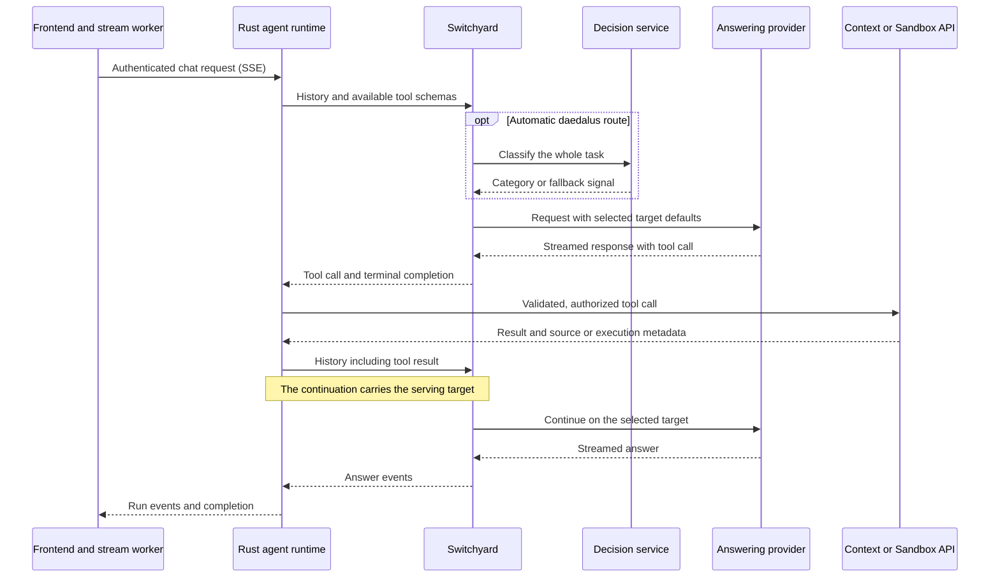

# Developing across Daedalus services

Use this guide when a feature crosses repository boundaries. Each service guide
owns its detailed setup; this page explains what to connect, which configuration
controls it, and how a result returns to the user.

## Follow a tool-backed answer



The Agent owns the loop and waits for a complete model response before executing
its proposed tools. Switchyard chooses and calls models. Context provides
information and infrastructure tools; Sandbox executes code. A model request
can use several of these services over successive rounds.

The frontend authenticates users, admits jobs and stores chat state in Redis.
Stream workers consume backend SSE, persist output and notify the browser over
WebSocket. The frontend's optional OpenAI/Anthropic compatibility API enters this
same queue and executes Agent tools when using the `daedalus` application alias.
Its optional `daedalus-model` alias forwards inference without the Agent loop.
Calling Switchyard's `/v1` API directly only calls models: the calling application
must execute any returned tool calls.
See the [Agent request path](../submodules/daedalus-agent/docs/architecture.md#request-path)
and [compatibility API](../submodules/daedalus-agent/docs/compatibility-api.md).

## Connect the model path

Configure the Agent's selected workflow and backend environment together:

| Agent setting | Role when using Switchyard |
| --- | --- |
| `TOOL_CALLING_LLM_MODEL_BASE_URL` | Gateway API root reachable from the backend, ending in `/v1` |
| `TOOL_CALLING_LLM_MODEL_MODEL` | `daedalus` for automatic routing, or an explicit alias from the selected routes |
| `TOOL_CALLING_LLM_MODEL_API_KEY` | Credential field used by the Agent client; upstream provider keys belong to Switchyard |
| `llms.<name>.api_type` in workflow YAML | `responses` or `chat`, matching the intended client protocol |
| `workflow.model_routes` | Maps explicit Agent profiles to gateway aliases |

The bundled gateway has no caller bearer-key requirement. If the selected Agent
configuration requires a nonempty key, use a non-secret placeholder for that
connection. Supply the real provider credentials to Switchyard through the
`api_key_env` references in its selected configuration. A direct-provider Agent
setup instead needs that provider's actual credential. Frontend application API
keys authenticate a different API and should not be sent to the gateway.

Omitting `model_profile` uses the configured main model. It enables automatic
classification only when that model resolves to the gateway's automatic route.
The full workflow maps `max`, `high`, `low` and `instant` to explicit aliases;
the minimal local workflow does not configure that mapping. Additional generic
Agent effort labels do not create gateway routes.

In Switchyard, discover `routes_*.toml` and select a profile explicitly. Shared
classifier settings live in `config/decision/elephant.toml`, category policy in
`config/routing/four-category.toml`, and provider definitions in `config/llms/`.
The blended profile selects targets from more than one provider. Read the composed
target's model and `extra_body` to determine native reasoning settings; a category
name is not a promise about a provider's reasoning, speed or price.

An automatic task uses the separately deployed decision service for its initial
choice. Tool continuations reuse the target and skip the judge. Classification
failure selects the configured default. Explicit aliases bypass classification.
Trimming classifier input preserves the model request. See
[decision routing](../submodules/daedalus-switchyard/docs/standalone-decision-routing.md).

Gateway generation responses are SSE, including when a direct caller omits
`stream` or sends `false`. Use a streaming client. The Agent's frontend
compatibility API can aggregate a completed Agent run into a non-streaming
response; that is a separate consumer-facing contract. Provider-affinity headers
come from the selected gateway client configuration. The agent supplies routing
identity separately from the provider affinity setting and the per-attempt
correlation ID.

## Connect the information layer

Context is a collection of APIs, rather than one proxy endpoint. Generate its
consumer settings from the Context root:

```bash
make render-agent-env
```

The output contains endpoints, model IDs and readiness policy. Merge those values
into the Agent deployment and provision credentials separately. When the Agent
Helm chart enables retrieval, translate the generated Milvus/readiness values
into `retrieval.*`; generic backend environment overrides cannot replace them.
The [Agent operations guide](../submodules/daedalus-agent/docs/operations.md#runtime-configuration)
lists the exact mapping.

### Curated search

Context publishes sources and refreshes shared domain collections. A refresh
discovers URLs or published PDFs, extracts and chunks content, embeds documents,
and writes to Milvus. The Agent's domain retriever resolves a configured domain
to its collection alias, embeds the query, searches Milvus, and optionally reranks
the candidates before returning passages and source metadata to the model.

Query and document embeddings must share the model revision and vector space,
including role/prefix handling, dimensions, normalization and truncation. Use
Context's `stack/rag-schema.yaml`, component lock and collection contracts when
changing either side. An embedding change can require a new collection generation;
service deployment alone does not re-embed stored documents.

The Agent uses `/rerank` and `results[].relevance_score`; NIM-compatible clients
use `/v1/ranking` and `rankings[].logit`. Scores are raw logits. The Rust domain
retriever preserves vector order if reranking fails or exceeds its search
deadline. Source identifiers survive in the tool result so the model can cite
the retrieved evidence. Existing search can continue while ingestion is down,
although new or refreshed content will be unavailable.

### Private uploads and memory

Private uploads use Agent-owned document APIs, user scope, collection metadata
and object storage. They can share NV-Ingest, embeddings and Milvus with curated
retrieval, but Context's refresh scheduler does not own their lifecycle.
Configure `NV_INGEST_HOST` and `NV_INGEST_PORT` for Agent ingestion; setting only
`NV_INGEST_ENDPOINT` is insufficient. Keep `EMBEDDING_MODEL` and
`EMBEDDING_NIM_MODEL_NAME` aligned: the latter identifies the embedding space in
upload metadata.

Hindsight stores durable memory in an externally maintained service. The Agent
reads memory and retains completed turns through its own integration. Context
can coordinate Hindsight deployment and expose its endpoint, but this checkout
does not contain its implementation. Redis chat history, Milvus documents and
Hindsight memory have separate ownership and retention rules.

### Infrastructure tools

The Agent connects directly to Kubernetes and UniFi MCP servers using their
configured endpoint and bearer token. Workflow exposure filters and approval
policies control which tools the Agent can call; server permissions still apply.
Large tool groups can advertise a `__connect` entrypoint and expose their full
authorized schemas after discovery. A successful MCP connection establishes
protocol access, not successful completion of a particular operation.

Check a mutation's returned result and relevant resource state before retrying.
The Agent distinguishes tool errors, JSON-RPC errors and uncertain transport
outcomes, and does not automatically replay uncertain mutations. The resulting
tool output goes into the next model request through Switchyard.

## Connect execution and artifacts

Choose the API according to the work:

| | Bubblewrap v1 | Exploration v2 |
| --- | --- | --- |
| Agent tool | `llm_sandbox_tool` | `sandbox_exploration_tool` |
| Configuration | `LLM_SANDBOX_BASE_URL`, `LLM_SANDBOX_API_KEY` | `EXPLORATION_BASE_URL`, `EXPLORATION_GRANT_KEY` |
| Request | Synchronous command with optional staged/collected files | Submit a run, then poll its status |
| Identity | Shared bearer key plus trusted opaque workspace ID | Signed owner/conversation/profile grant |
| Persistence | Optional files in one pod until expiry or replacement | Accepted file snapshots in object storage; metadata in PostgreSQL |

V1 discovers `/v1/commands` (an alias of `/v1/capabilities`) and executes
`POST /v1/execute`. Prefer `argv` with staged files. Offline `check-*` and `lint-*`
wrappers use image-owned settings and require dependencies to be staged; they
do not install packages. Check `exitCode`, timeout and truncation fields to
decide whether the work succeeded. The default isolated network also applies
to programs such as `curl`.

V2 runs offline Python/data experiments in fresh OpenShell runtimes. Session
generations and mutation idempotency keys protect file updates. Recovery restores
accepted files, not process memory; ambiguous started runs become lost after
cleanup rather than being replayed. There is no automatic fallback between v1
and v2. See [Sandbox architecture](../submodules/daedalus-sandbox/ARCHITECTURE.md).

For either API, collecting a file is only the first half of delivery. The Agent
checks the returned bytes and calls the frontend's authenticated artifact
publisher, which stores the file and returns a download link. Configure
`DAEDALUS_ARTIFACT_PUBLISH_URL`, the internal credential and Agent object storage
alongside the sandbox connection. A sandbox path alone is not a browser URL.

## Develop and check a change

Start from the component that owns the behavior, then test its immediate consumer.
The repositories provide different local checks:

| Repository | Useful starting check | What it covers |
| --- | --- | --- |
| Agent | `make help`, then the focused checks in its contributor guide | Rust, Python, frontend and built backend contracts |
| Switchyard | `python3 -m unittest discover -s tests -v` | Route composition and gateway contracts; HTTP tests need `SWITCHYARD_TEST_BINARY` |
| Context | `make validate-context` | Stack contracts, contract tests and seven owned charts without cluster access |
| Sandbox | `python3 -m unittest discover -s tests -v` | V1 server/tooling and deployment contracts; v2 database tests use a separate disposable database |

For a model transport change, exercise the built Agent through the built gateway
with a synthetic provider, including a tool continuation and a terminal error.
For retrieval, use a known query and expected source passage through the Agent's
tool. For sandbox work, stage a small program, check its result, then publish and
download a generated artifact. These checks answer different questions from
service readiness or a provider-only probe.

Use `x-request-id` and Agent model-call logs to trace a model attempt. A gateway
retry may reuse that ID, while another Agent attempt receives a new one. Keep
MCP session IDs, ingestion job IDs, sandbox execution IDs and exploration run IDs
as their own identities. See [Agent runtime logs](../submodules/daedalus-agent/docs/operations.md#runtime-logs).

## Find the failing connection

Use the last successful step to narrow a problem before changing configuration:

| Symptom | Start with |
| --- | --- |
| Chat is queued but never reaches the backend | Frontend admission, Redis queue and stream-worker logs |
| Backend is ready but model calls fail | Effective model URL, API type, alias and gateway/provider credentials |
| Explicit aliases work but automatic routing always falls back | Decision-service discovery, tokenizer and classifier deadline |
| A direct gateway client expects JSON but receives events | Consume SSE, or use the Agent compatibility API's non-streaming run response |
| Curated search works but new documents do not appear | Refresh Job completion, source status, NV-Ingest and collection generation |
| Curated search works but private uploads fail | Agent upload settings, user-scoped collection metadata and object storage |
| Sandbox execution succeeds but the file cannot be downloaded | Collection completeness, frontend publication response and authenticated download |
| An MCP mutation loses its connection | Inspect the resource state before deciding whether another mutation is needed |

Readiness, workload logs and returned tool results each show a different step.
For example, `/health` on Switchyard does not call the classifier or answering
provider, and static sandbox capabilities do not run a program. Once the failing
step is repaired, repeat the original task through its consumer.

## Deploy a connected stack

Each repository's `make deploy` publishes its selected owned images and reconciles
its services. There is no parent command that installs every dependency. Configure
the model/decision services, selected Context services and selected sandbox APIs,
then configure the Agent to use their reachable endpoints and credentials.
Context component selections do not automatically add dependencies. Its Compose
file is an image inventory; its runtime deployment is Kubernetes.

Update both ends of each network connection: backend egress and provider ingress,
including their actual namespaces, labels and ports. Service environment variables
do not generate those policies. Preserve existing NodePorts, ingress routes and
ordinary LAN clients when changing an installation. The Agent chart's exploration
integration also requires its signer Secret even before the first tool call.

Use the owner's deployment guide for backups and rollout verification. Agent
runs live in the backend process, v1 files live in sandbox pods, and v2 accepted
files live in durable storage; a rollout has different recovery consequences for
each. Corpus publication and collection refresh are separate data operations.
Switchyard deployment includes real provider capability calls, so a local config
review should use its offline tests rather than `make deploy` or `make test`.
